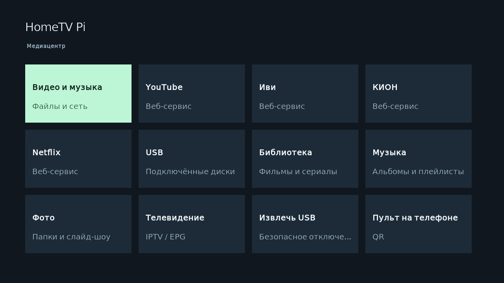

# HomeTV Pi

Медиацентр для Raspberry Pi 3B, 3B+ и 4B с одним образом Raspberry Pi OS Lite arm64. Главный экран — штатный Kodi Estuary с разделом HomeTV Pi. Локальное медиа открывается в Kodi, официальные стриминговые сайты — в Chromium на весь экран. В разделе **Игры** есть эмуляторы Dendy/NES, Sega Mega Drive и PlayStation 1. HDMI-CEC, геймпады, USB-носители и аппаратное воспроизведение входят в [приёмку на платах](docs/test-report.md) и имеют статус **[НЕ ПРОВЕРЕНО НА УСТРОЙСТВЕ]**.

## Быстрый старт

1. Возьмите собранный `HomeTV-Pi-0.3.0-arm64.img.xz` и сверьте SHA-256 с одноимённым файлом `.sha256`. Для сборки из этого репозитория выполните `bash build/image.sh` на Linux с Docker. [Подробности сборки](docs/build.md).
2. Откройте Raspberry Pi Imager и выберите **Use custom / Использовать свой образ**. Укажите `.img.xz`, затем выберите microSD объёмом от 16 ГБ. Запись стирает содержимое выбранной карты.
3. Подключите экран и клавиатуру, вставьте карту и включите Pi. На Pi 4 используйте порт HDMI0 рядом с USB-C для 4K60. При первом старте `/data` расширяется на доступное место.
4. Если нужен SSH с первого запуска, скопируйте публичный ключ Ed25519 на загрузочный раздел под именем `hometv-ssh.pub`. Вход — `ssh tvadmin@АДРЕС`, права администратора доступны через `sudo`. На чистом образе без этого файла SSH выключен.
5. Выберите язык, часовой пояс и раскладку. Ethernet получает адрес по DHCP. Для Wi-Fi воспользуйтесь экранным мастером. PIN телефона задаётся вами.
6. Откройте раздел **HomeTV Pi** в боковом меню Kodi. **Home** возвращает в Estuary, **F8** открывает быстрый экран плиток. **Home / F12** закрывают браузер или игру и возвращают Kodi. QR-код открывается в плитке **Пульт на телефоне**.

`0.3.0` — сборка для аппаратной приёмки. В [отчёте проверки](docs/test-report.md) указано, какие сценарии прошли на хосте и какие ещё предстоит выполнить на устройствах. Для обновления сохраните текущую карту и используйте вторую. [Резервные копии и обновление](docs/update.md).

## Документация

- [Руководство пользователя и устранение неполадок](docs/user-guide.md)
- [Архитектура, выбор arm64 и Widevine](docs/research.md)
- [Таблица совместимости сервисов](docs/compat.md)
- [Каталог сервисов и управление браузером](docs/streaming.md)
- [Ретроконсоли и запуск игр с USB](docs/games.md)
- [Сборка, CI и каталог Raspberry Pi Imager](docs/build.md)
- [Ограничения](docs/limitations.md) и [отчёт проверки](docs/test-report.md)
- [Лицензии и источники контента](docs/licenses.md)
