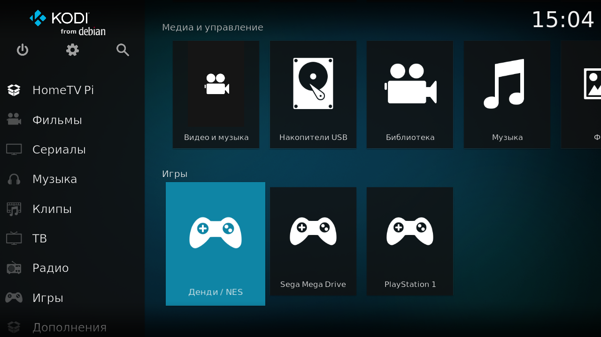

# Ретроконсоли HomeTV Pi

В Kodi откройте **HomeTV Pi → Игры** и выберите **Денди / NES**, **Sega Mega Drive** или **PlayStation 1**. Выберите накопитель, затем файл игры. Можно запустить файл прямо с USB или открыть его из `/data/home/roms/nes`, `/data/home/roms/megadrive` либо `/data/home/roms/psx`. Ядро выбирается по консоли. RetroArch запускается через Cage и возвращает управление Kodi после выхода. [Исходники RetroArch](https://github.com/libretro/RetroArch).

| Консоль | Ядро | Входные файлы |
| --- | --- | --- |
| Dendy / NES / Famicom | [Nestopia UE](https://github.com/0ldsk00l/nestopia) | `.nes`, `.unf`, `.unif`. Для `.fds` нужен собственный `disksys.rom` в `/data/home/bios/nes`. Если игра идёт с неверной скоростью, откройте **Quick Menu → Core Options**, установите **Favored System → Dendy** и запустите игру заново. |
| Sega Mega Drive / Genesis | [Genesis Plus GX](https://github.com/libretro/Genesis-Plus-GX) | `.md`, `.gen`, `.bin`, `.smd`. Для картриджей BIOS не требуется. Ядро поставляется на некоммерческих условиях. |
| PlayStation 1 | [PCSX ReARMed](https://github.com/libretro/pcsx_rearmed) | `.cue` вместе со всеми дорожками, `.chd`, `.pbp`, `.iso` и `.m3u` для нескольких дисков. Указывайте в CUE и M3U относительные пути к соседним файлам, текст сохраняйте в UTF‑8. |

Для PS1 можно добавить BIOS, снятый со своей консоли, в `/data/home/bios/psx`, например `scph5501.bin`. Без отдельного BIOS ядро может использовать встроенную HLE. Совместимость зависит от конкретной игры. Образ содержит эмуляторы. ROM и BIOS пользователь добавляет самостоятельно. [Поддерживаемые BIOS PCSX ReARMed](https://docs.libretro.com/library/pcsx_rearmed/#bios) · [Опции Nestopia](https://docs.libretro.com/library/nestopia/).

Подключите USB-геймпад до запуска игры. Для поддерживаемых моделей используются профили RetroArch. На клавиатуре стрелки задают направление, `X` / `Z` / `S` / `A` назначены на лицевые кнопки RetroPad, `Enter` — Start, правый `Shift` — Select. `F1` открывает меню RetroArch. С геймпада это меню открывается при удержании Start две секунды. Выход в Kodi — `F12` или `Start + Select`. Если RetroArch завис, нажмите **Главный экран** в веб-пульте.

Сохранения, карты памяти PS1, состояния и настройки каждого ядра хранятся на `/data/home/.local/share/home-tv/retroarch/<консоль>/`. Обычные сохранения периодически записываются на диск. Состояния вручную сохраняются из Quick Menu. Для PlayStation сначала убедитесь, что игра закончила запись карты памяти, затем выходите в Kodi.

Работа на Pi 3B+ и Pi 4B, физические геймпады и скорость PS1 **[НЕ ПРОВЕРЕНО НА УСТРОЙСТВЕ]**. На этих платах проверьте запуск игры с USB, звук, управление, сохранение, повторное открытие и возврат в Kodi. [Протокол приёмки](test-report.md).

## Локальные головоломки

Пять головоломок и LBreakoutHD из 0.2.0 доступны через запасной экран **F8 → Головоломки**. Основной ряд **Игры** в Estuary открывает ретроконсоли.

| Игра | Действие |
| --- | --- |
| Судоку (Solo) | Заполнить сетку цифрами. Выбирайте клетку стрелками пульта, вводите цифры клавиатурой или цифровыми кнопками CEC, если телевизор их передаёт. |
| Пятнашки (Fifteen) | Поставить плитки в порядке от 1 до 15. Стрелки двигают соседнюю плитку. |
| Мосты (Bridges) | Соединить острова мостами по числам на них. Используйте стрелки и OK или курсор и мышь. |
| Лампочки (Light Up) | Осветить все свободные клетки. Стрелки выбирают клетку, OK ставит или снимает лампу. |
| Сапёр (Mines) | Открыть безопасные клетки и отметить мины. Стрелки выбирают клетку, OK открывает, жёлтая кнопка пульта или пробел ставит флажок. |
| LBreakoutHD | Отбивайте мяч платформой и разбивайте кирпичи. Игра открывается в режиме курсора. Удобнее управлять мышью или тачпадом веб-пульта. |

Для выхода используйте **F12** на клавиатуре, **Главный экран** в веб-пульте или **Home/Root Menu**, если пульт передаёт эту кнопку приставке. **F9** и синяя кнопка переключают пульт между стрелками и курсором. В режиме курсора **OK** — левый щелчок, жёлтая кнопка — правый. Для пультов, которые присылают другой код кнопки, в `keymap` файла `/data/config/input.json` можно указать действие `secondary`. [Настройка ввода](streaming.md).

Настройки и домашний каталог каждой игры находятся в `/data/home/.local/share/home-tv/games/<id>/`. Чтобы сохранить партию головоломки, используйте меню **Game → Save** и выберите этот каталог. LBreakoutHD хранит личные настройки и результаты в подкаталоге `.lbreakouthd`. Копия настроек медиаприставки не включает сохранённые игры.

Сборка берёт игры из подписанного репозитория Debian Trixie. Simon Tatham’s Portable Puzzle Collection распространяется под лицензией MIT, код LBreakoutHD — под GPLv3. Интерфейс и встроенные справки головоломок могут быть на английском. [Пакет sgt-puzzles](https://packages.debian.org/trixie/sgt-puzzles) · [Правила и лицензия головоломок](https://www.chiark.greenend.org.uk/~sgtatham/puzzles/doc/) · [Пакет LBreakoutHD](https://packages.debian.org/trixie/lbreakouthd).

Работа на Pi 3B+ и Pi 4B, физические пульты и режим выхода помечены **[НЕ ПРОВЕРЕНО НА УСТРОЙСТВЕ]**.
