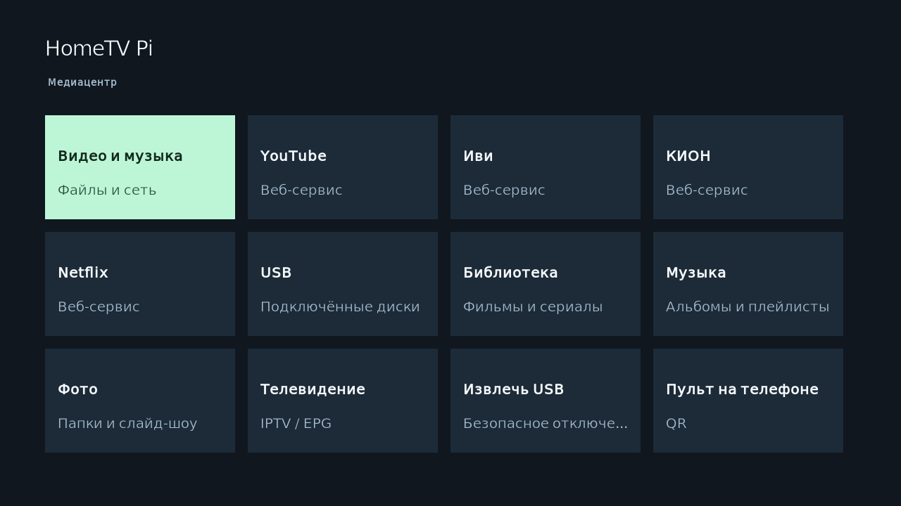
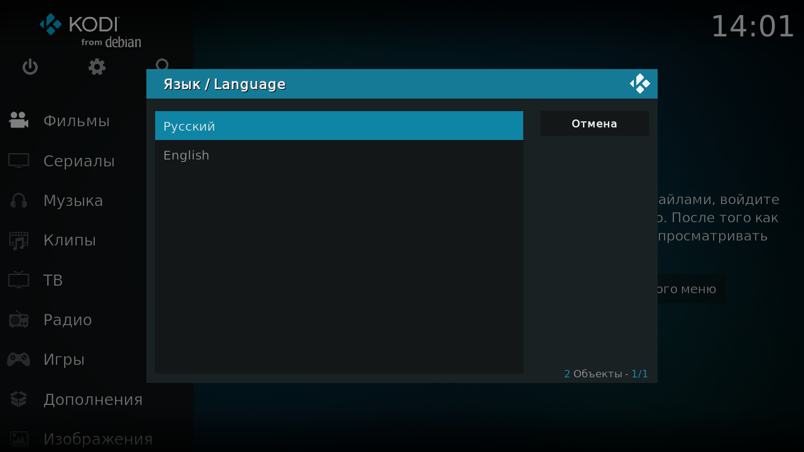

# Руководство пользователя HomeTV Pi

## С чего начать

Запишите `.img.xz` в Raspberry Pi Imager. Подключите HDMI и клавиатуру. Если есть Ethernet, подключите кабель перед включением. При первом включении системе требуется время для подготовки раздела `/data`.

Снимки сделаны в Kodi на Linux с виртуальным экраном. Интерфейс Raspberry Pi через HDMI и композит **[НЕ ПРОВЕРЕНО НА УСТРОЙСТВЕ]**.

В мастере можно выбрать русский или английский язык, часовой пояс, раскладку, Wi-Fi и PIN. При отмене мастера до сохранения выбора он запустится снова при следующем старте Kodi. Расширенные настройки запрашиваются из плитки **Настройки**. Разрешение, масштаб, калибровку, вывод AC3/DTS и аудиоустройство Kodi ищите в системных настройках Kodi. Аудиовыход браузера выбирается отдельно из списка PipeWire. Для Bluetooth откройте **Настройки → Bluetooth** после перевода колонки или наушников в режим сопряжения.

## Локальная библиотека

- **USB** показывает смонтированные разделы. Выберите диск, папку и файл. Для безопасного извлечения сначала остановите видео или музыку, затем используйте **Извлечь USB**. Для внешнего HDD используйте хаб со своим питанием.
- **Видео и музыка** открывает браузер источников Kodi. Добавьте `smb://` или `nfs://` из **Добавить источник**. Для автоматических обложек задайте тип содержимого папки и включите сканирование. Плитки **Библиотека**, **Музыка** и **Фото** используют стандартные каталоги Kodi.
- Аудиодорожки и субтитры выбираются в меню текущего фильма. Если текст исказился, проверьте кодировку субтитров в настройках плеера, например Windows-1251. Внешние субтитры в UTF‑8 снижают зависимость от автоопределения. На ресивере проверьте формат PCM до включения passthrough.
- Для IPTV настройте установленный **PVR IPTV Simple Client** на ваш легальный M3U и EPG. Затем откройте **Телевидение**. Для каждого источника действуют условия поставщика контента.

## Веб-сервисы и телефон

Плитки открывают официальные сайты. После закрытия браузера система возвращается в Kodi. В Chromium нажмите **Home / F12** для выхода и **F9** для режима курсора. Если телевизор передаёт нужные события CEC, используются Home/Root Menu и синяя кнопка. Для Flirc назначьте F12 и F9 в его приложении. [Привязки и пользовательский `input.json`](streaming.md).

На плитке **Пульт на телефоне** выберите локальный адрес, отсканируйте QR и введите PIN. Используйте ту же локальную сеть. Браузер покажет предупреждение о собственном сертификате устройства. Сверьте его отпечаток с экраном перед входом. До задания PIN панель не слушает сеть. Телефон отправляет латиницу в активное поле при английской раскладке Chromium. Для входа выберите поле курсором, затем отправьте строку.

В HTTPS-панели доступны пульт, тачпад, каталог сервисов, PIN на отдельных плитках, диагностика, Wi-Fi, SSH и копирование настроек на USB. Изменения плиток отображаются после повторного открытия главного экрана. PIN защищает ярлыки лаунчера и доступ к панели. Если нужен родительский контроль контента, настройте также детский профиль у провайдера и ограничения сети.

## SSH

Чтобы SSH с правами администратора заработал при первой загрузке, положите **публичный** ключ Ed25519 на доступный с Windows загрузочный раздел microSD и назовите файл `hometv-ssh.pub`. После подключения Pi к сети войдите командой `ssh tvadmin@АДРЕС`. Для обслуживания используйте `sudo`. Парольный вход отключён.

Настройка через **Wi-Fi и SSH** в HTTPS-панели подходит для обычного доступа без `sudo`. Если административный ключ уже установлен с карты, панель может выключить и снова включить SSH с тем же ключом. Для смены административного ключа обновите `hometv-ssh.pub` на карте и перезапустите устройство. [Копирование и восстановление](update.md).

## Устранение неполадок

| Ситуация | Что проверить |
| --- | --- |
| Чёрный экран | Подключите HDMI до включения, выберите правильный вход ТВ. Для Pi 4 сначала используйте HDMI0 и экран 1080p. Проверьте питание, кабель, SHA-256 образа и запись карты. |
| Старый аналоговый телевизор | Для SDR/PAL на Pi 3/4 требуется KMS overlay с параметром `composite`, подходящий четырёхконтактный кабель и настройка PAL/NTSC в `cmdline.txt`. Для Pi 4 также требуется `enable_tvout=1`. Это ручная настройка на загрузочном разделе запасной карты, при которой HDMI на Pi 3/4 недоступен. [Документация Raspberry Pi](https://www.raspberrypi.com/documentation/computers/config_txt.html). |
| Нет звука | В Kodi проверьте выход, формат PCM и уровень громкости. Для Chromium откройте **Аудиовыход браузера**. Для Bluetooth проверьте статус подключения, затем выберите профиль вывода. |
| Видео тормозит | Для Pi 3 начните с H.264 8 бит 1080p30 или 720p60. В браузере снизьте качество. Для HEVC и 4K используйте Pi 4. Проверьте температуру и `get_throttled` в панели. |
| Не видно USB | Проверьте, что диск получает питание, и попробуйте другой порт без хаба. После подключения откройте USB повторно. NTFS после гибернации Windows следует корректно отключить на ПК. |
| Не получается войти в сервис | Проверьте дату, интернет и требования провайдера для браузера и региона. При первом запуске Chromium может загружать Widevine. Откройте плитку повторно после загрузки компонента. Если YouTube TV не показывает код, используйте обычный YouTube. |
| QR не открывается | Подключите оба устройства к одной локальной IPv4-сети. Гостевой Wi-Fi с изоляцией клиентов запрещает такой доступ. После задания PIN откройте QR повторно через несколько секунд. |

В справке [совместимости](compat.md) указаны сценарии, которые требуют проверки с реальными аккаунтами. Доступность сервиса и разрешение зависят от провайдера, региона и устройства.
